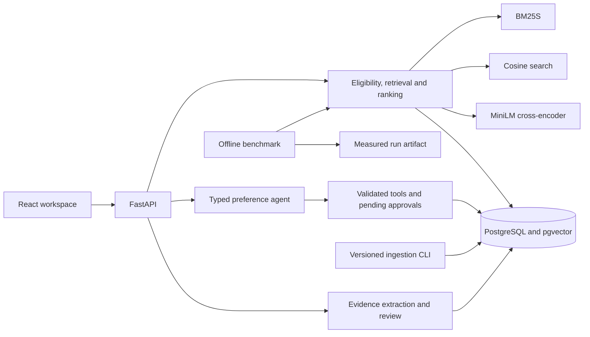

# Architecture

One FastAPI service owns authenticated accounts, profile review, the preference log, and match runs. PostgreSQL owns persistence. SQLite provides an embedded development path with exact cosine computation over the same stored vectors. The Docker and CI integration path exercises PostgreSQL.

## Durable records

| Record | Invariants |
| --- | --- |
| Users and profile versions | Identity fields live outside ranking inputs. Evidence has source, excerpt, skill and review status. Profile edits allocate a new version. |
| Preference events and feedback | Append-only per account. A confirmed mutation checks its base version; history records source text and supersession. Feedback deductions become proposals. |
| Jobs and job versions | Stable canonical key. Raw source and normalized versions remain available for replay. A content-addressed cache reuses vectors for unchanged model inputs. |
| Match runs and decisions | Store query, time, profile and preference versions, job revision IDs, weights, model revisions, retrieval sources, reasons, and actual score components. |
| Agent runs and tool calls | Run metadata, bounded attempts, tool names, validation, duration, usage. Avoid storing raw candidate documents in observability metadata. |
| Evaluations | Versioned corpus, queries and labels enter the same ranking service. The dashboard serves the benchmark's generated artifact. |

## Serving semantics

Eligibility is evaluated before top-k selection. Hard constraints can pass, fail, or need verification. Unresolved dealbreakers appear in the review list. The inspector may show a blocked role's raw similarity in an explicitly labeled diagnostic view. Within eligible jobs, BM25 and cosine are normalized independently on their retained candidates, fused, optionally cross-encoded, then adjusted by supported skill coverage and bounded preference weights. Stable job IDs break exact ties. Scores are ranking signals.

The counterfactual uses the same frozen run context and replaces a single input. A hypothetical skill changes skill coverage without adding candidate evidence. Historical display reads the stored decision, while counterfactual reruns recompute selection and ranking against the saved snapshot. Each run exposes dependencies and degraded modes.

## Scale path

At roughly 10K jobs, profile filters in SQL and batch embedding/reranking on CPU. At larger scales measure selectivity, p95, filtered exact recall and rerank saturation. Consider partitioning by stable job dimensions, an incremental embedding worker with idempotent batches, and HNSW or IVFFlat at measured thresholds. Version model vectors side by side during backfill, then atomically change the reviewed index. Load test reranker concurrency and tune connection pools before multiplying API replicas.
