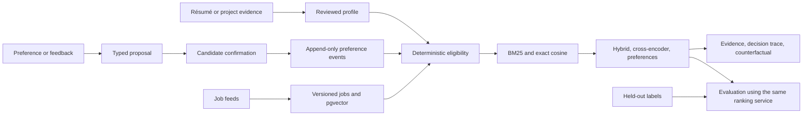

# MatchBench AI

## Why this project exists

MatchBench is an engineering benchmark for job retrieval, ranking, personalization, explainability, preference memory, and reliable AI-agent behavior. A candidate can see which roles they can pursue and the evidence behind each recommendation. An engineer can replay the same decision, change one assumption, and reproduce the ranking benchmark.

**[Open the recruiter demo](https://matchbench-ai-aadi.vercel.app)** and select **Inspect a rejected match**. The demo sets aside a semantically similar role that requires five years of experience. Open **Decision trace** for the eligibility checks and scores. Then select the Hyderabad role and use **What if?** to recompute its rank if Hyderabad were acceptable.

### What the demo shows

| Question | Where to look |
| --- | --- |
| Which jobs fit the candidate’s goals and constraints? | Daily matches and Job explorer |
| What evidence backs that claim? | Candidate profile and the match’s evidence links |
| What happens if one assumption changes? | Counterfactual Match Inspector |
| Which preferences changed, and when? | Feedback & memory and its event history |
| What did each ranking stage contribute? | Decision trace and the stored match run |
| How did the methods perform? | Evaluation and the raw benchmark artifacts |

The 42 postings are illustrative. The demo profile uses public project evidence, with a zero-year experience setting for the eligibility example. Every demo visitor gets an isolated session. The shareable preview uses a durable Supabase PostgreSQL database with pgvector and row-level security enabled.

## Measured results

Fifty held-out queries across ten intent families were evaluated on the same 42-job corpus. A separate ten-query development split selected the fusion weight. A posted grade of 2 or 3 counts as relevant for binary metrics.

| Method | Precision@5 | Recall@10 | MRR | nDCG@10 | p95 ranking |
| --- | ---: | ---: | ---: | ---: | ---: |
| Keyword overlap | .440 | .655 | .896 | .682 | 0.6 ms |
| BM25 | .488 | .718 | .938 | .725 | 0.8 ms |
| MiniLM embeddings | .540 | .892 | .980 | .848 | 9.1 ms |
| Hybrid | .548 | .881 | .960 | .832 | 8.3 ms |
| Hybrid + cross-encoder | .564 | .860 | .962 | .826 | 136.5 ms |
| Hybrid + cross-encoder + preferences | .624 | .894 | .964 | .849 | 133.7 ms |

On this fixture, preference-aware ranking found more relevant roles in the top five. The paired topic-bootstrap interval for the nDCG@10 difference versus embeddings crosses zero. The cross-encoder alone raised top-five precision relative to hybrid, reduced nDCG@10, and added latency. Embedding-only search remains available as a cheaper ranking option. These are local warm-model measurements, with cached query embeddings, on curated fixtures. See [ranking metrics](data/benchmark.json) and [label methodology](EVALUATION_PLAN.md).

In a separate generated load test, the index ingested **3,072 jobs**, reused every embedding on identical re-import, and re-embedded **64 of 128 updated jobs**. The 64 metadata changes kept their existing vectors. [Index load measurements](data/load_benchmark.json)

The explanation contract passed **36 of 36** evidence and missing-skill checks. A local Qwen2.5 1.5B model produced **28 of 32** preference proposals that passed validation and **24 of 32** that matched the expected intent. The rule-based path matched 29 of these 32 narrow cases. The hosted preview uses the rule-based path and confirmation. [Agent evaluation](data/agent_benchmark.json)

## How it works



### Retrieval and rank

- **Eligibility first.** Employment type, experience range, city and relocation, explicit exclusions, pay, graduation, authorization, availability, and expiration are evaluated independently. Unknown hard checks are shown for review. The diagnostic list can display raw similarity for excluded jobs.
- **Candidate generation.** BM25S and the 384-dimensional MiniLM bi-encoder each produce up to 100 eligible hits. PostgreSQL computes exact cosine using pgvector. Local SQLite uses the dot product of the same normalized vectors. Each retained channel is min–max normalized, with zero contribution for an absent result and 1 for a tied constant channel. The development split sets `alpha` for `alpha × cosine + (1 − alpha) × BM25`.
- **Ranking.** Rerank the first 20 hybrid candidates using a quantized MiniLM cross-encoder. Its normalized score contributes 60% of the rerank blend, followed by bounded skill and preference adjustments. Model revisions, component scores, checks, effective ranking method, and weights are stored with the run. Scores are ranking signals.
- **Evidence.** Only accepted excerpts supply skill evidence. Pending review appears under open questions. Missing skills are reported directly. If no result reaches the Daily Matches criteria, the screen says **No strong matches**.
- **Counterfactuals.** Replay the recorded effective algorithm against the same query, job revisions, profile version, preference version, and evaluation time with one changed input. A hypothetical skill contributes to simulated coverage. The source evidence and saved memory stay as recorded.

### SQL and state

`users` owns profile versions, preference events, feedback, agent runs, and match runs. `candidate_evidence` points to a profile version. `jobs` points to a current revision in `job_versions`. A content key built from model revision and indexed text links job versions to shared `job_embeddings`. `match_results` stores the eligibility and score record for a run. `index_imports` records the last refresh and its counts.

PostgreSQL takes a transaction advisory lock for ingestion and queries existing IDs, fingerprints, and embedding keys in batches. A single transaction updates jobs and introduces their revisions. Profile changes and preference confirmation check the base version under a row lock. Foreign keys cascade account deletion. Compound unique indexes support historical lookups and guard version races. [Architecture](ARCHITECTURE.md)

### Agent and failure handling

One bounded agent may read preferences or draft a typed patch. Confirmation applies it against the saved version. An OpenAI-compatible tool endpoint can return function calls. A small-model schema mode returns a typed intent with an explicit tool dispatch. The audit captures provider, attempts, token usage when available, tool name, validation outcome, and elapsed time. Unknown fields, contradictions, and unconfirmed feedback cannot update memory.

With the text model unavailable, the demo interprets common examples locally and search continues. Embedding failures fall back to BM25 and reranker failures fall back to hybrid. The UI shows the effective method. Invalid uploads produce actionable errors. Stale ingestion is surfaced as a search warning. `/health`, `/ready`, and `/api/observability` expose service, corpus, and latency information.

## Setup

### PostgreSQL and Docker

```bash
docker compose up --build
```

Open [the local app](http://127.0.0.1:8000) or [API docs](http://127.0.0.1:8000/docs). Compose runs migrations and an idempotent import before serving. The bundled ONNX artifacts target x86-64 with AVX2.

### Native Windows or Linux

Create and activate a Python 3.12 virtual environment, then run these commands from the repository root. Node.js 24 is used by CI.

```bash
python -m pip install ".[dev]"
python -m matchbench.cli models
python -m alembic upgrade head
python -m matchbench.cli ingest
npm ci --prefix frontend
npm run build --prefix frontend
python -m uvicorn matchbench.api:app --host 127.0.0.1 --port 8000 --no-access-log
```

The native path defaults to SQLite. Set `DATABASE_URL` to a PostgreSQL URL before migration to use pgvector. Optional `OPENAI_API_KEY` enables the configured model for authenticated accounts. Set `ALLOW_DEMO_LLM=true` to run it for demo sessions as well. For a loopback OpenAI-compatible service, set `LLM_BASE_URL`, `LLM_MODEL`, and `LLM_MODE=schema` when the provider supports constrained JSON. [Environment template](.env.example)

### Ingest and reproduce

```bash
python -m matchbench.cli ingest data/jobs.json
python -m matchbench.benchmark --output local-ranking.json
python -m matchbench.load_benchmark --size 3072 --output local-load.json
python -m matchbench.benchmark --contracts-only --output local-agent.json
# With a configured model:
python -m matchbench.benchmark --contracts-only --live-llm --output local-model.json
```

The ingest CLI accepts validated JSON arrays or CSV with pipe-delimited skill/location lists. Import data with redistribution permission. In a live environment, rerun ingestion with updated source files. Ranking metrics are reproducible on pinned inputs. Latency varies by host and cache state.

## API and tests

| Endpoint | Purpose |
| --- | --- |
| `POST /api/search` | Execute filters, retrieve, rank, and save a match run |
| `GET /api/runs/{id}` | Retrieve an owned run’s exact stored output and provenance |
| `POST /api/runs/{id}/counterfactual` | Recompute one hypothetical change |
| `POST /api/profile/extract` | Preview PDF, DOCX or text extraction |
| `GET /api/preferences` | Read saved preferences and events |
| `POST /api/agent` and `POST /api/agent/{id}/confirm` | Interpret then confirm a preference |
| `POST /api/feedback` | Record a reason and surface a reviewable suggestion |
| `GET /api/evaluation` | Read actual generated benchmark artifacts |
| `GET /api/account/export`, `DELETE /api/account` | Export and delete candidate data |

```bash
ruff check matchbench migrations tests
mypy matchbench
pytest -q
npm run check --prefix frontend
npm run build --prefix frontend
# With the app running, install a browser and run the walkthrough tests:
cd frontend
npx playwright install chromium
npm run test:e2e
```

GitHub Actions runs lint, type checks, backend tests including a PostgreSQL/pgvector service, and the frontend build. Browser checks cover the rejected-role explanation, counterfactual, preference confirmation, reload persistence, and keyboard focus at 320, 768, 1024, and 1440 px.

### Privacy and fairness

Passwords are Argon2-hashed. Sessions use signed, HTTP-only cookies. Ownership gates profile and match data. Uploads are type-checked, size-limited, and parsed without saving the original file. Application logs exclude resume text. Structured ranking inputs draw from role requirements, accepted skill evidence, and candidate-approved constraints. Identity fields and protected characteristics are excluded from ranking input. A name-perturbation regression checks invariant results. The fairness tests cover these boundaries on fixtures.

### Deploying

Use the Docker image on a Python-capable container host, or the included Vercel FastAPI build with the Vite frontend. Set a durable `DATABASE_URL` and a unique `SESSION_SECRET` as host secrets, and set `SECURE_COOKIES=true`. Run `alembic upgrade head` and index the demo file against that database before routing traffic. Check `/ready` for PostgreSQL and model availability, then walk the recruiter demo.

The public deployment runs in Vercel's Mumbai region and uses Supabase's Mumbai transaction pooler. Candidate and account tables have row-level security enabled, public Data API roles have no table grants, and the server connects with a dedicated backend role. Use the local setup for private resume data.

### Limits and next experiments

Ranking judgments cover a small, authored corpus. The larger index benchmark uses generated records only and measures ingestion and runtime behavior. The current exact retrieval path reads the active corpus. Larger deployments would move selectivity-critical fields to indexed columns, measure filtered ANN recall, and batch index and reranker work. The demo uses per-process request limits and has no external usage or hiring-outcome evidence. For a real candidate pilot, evaluate a licensed index, independent judgments, and monitored deployment behavior.

[2–3 minute demo and interview guide](DEMO.md) · [Résumé bullets](RESUME_BULLETS.md) · [Research](RESEARCH.md) · [Evaluation plan](EVALUATION_PLAN.md)
